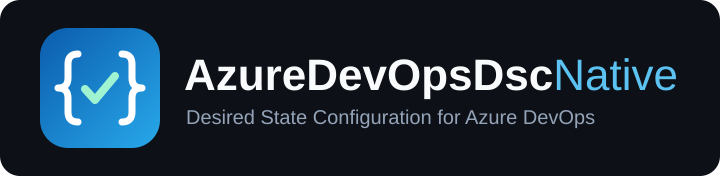

<p align="center">
  
</p>

[](https://github.com/ZanattaMichael/AzureDevOpsDsc/actions/workflows/build.yml?query=branch%3Amain)
[](https://github.com/ZanattaMichael/AzureDevOpsDsc/actions/workflows/unit-tests.yml?query=branch%3Amain)
[](https://github.com/ZanattaMichael/AzureDevOpsDsc/actions/workflows/publish.yml)
[](https://www.powershellgallery.com/packages/AzureDevOpsDscNative)
[](https://www.powershellgallery.com/packages/AzureDevOpsDscNative)
[](https://www.powershellgallery.com/packages/AzureDevOpsDscNative)
[](https://github.com/ZanattaMichael/AzureDevOpsDsc/releases/latest)
[](https://learn.microsoft.com/powershell/)
[](https://learn.microsoft.com/powershell/dsc/overview)
[](LICENSE)

**AzureDevOpsDscNative** is a PowerShell module of 84 class-based DSC resources that manage an
Azure DevOps organization as configuration: projects, repositories, permissions, pipelines, boards,
process customization, artifacts and more.

> This is a fork of [dsccommunity/AzureDevOpsDsc](https://github.com/dsccommunity/AzureDevOpsDsc), published
> separately as **AzureDevOpsDscNative** to add native DSC v3 support: every resource is
> discoverable and invokable by `dsc.exe` via the `Microsoft.Adapter/PowerShell` adapter, using
> generated adapted resource manifests - no wrapper resource required. See also
> [@mimachniak's AzureDevOpsDscv3](https://github.com/mimachniak/AzureDevOpsDscv3), which takes a
> different approach (a `Microsoft.Windows/WindowsPowerShell` wrapper) to the same goal.

## Contents

- [Highlights](#highlights)
- [What is new in 2.0](#what-is-new-in-20)
- [Installation](#installation)
- [Quick start](#quick-start)
- [Authentication](#authentication)
- [Security](#security)
- [Resources](#resources)
- [Documentation](#documentation)
- [Testing](#testing)
- [Releases](#releases)
- [Contributing](#contributing)

## Highlights

- **84 resources** covering projects, teams and groups, entitlements, Git repositories and branch
  policies, permissions across the security namespaces, pipelines and environments, boards, test
  management, inherited-process customization, artifacts, wikis, extensions and auditing.
- **Works with DSC v3 and with `Invoke-DscResource`.** The same resources run through `dsc.exe`,
  PowerShell DSC, or [`Dsc.PipelineRunner`](USAGE.md#implementation-using-dscpipelinerunner).
- **Six ways to sign in**, including managed identity and workload identity federation, so no
  long-lived secret is needed.
- **Export of an existing organization** into configuration, to onboard what is already there. See
  [Onboarding an Existing Organization with Export](USAGE.md#onboarding-an-existing-organization-with-export).
- **Secrets stay out of configuration.** Resources accept a reference to an environment variable or
  a SecretManagement vault instead of the secret itself.
- **Hardened by default.** Credentials are only sent to Azure DevOps hosts, secrets are redacted
  from logs and errors, and the stored credential and cache are owner-only and, on Windows,
  DPAPI-encrypted. See [Security](#security).

## What is new in 2.0

Version 2.0.0 is a major release with breaking changes to how credentials are handled. The
[change log](CHANGELOG.md) has the full list.

- **Breaking:** `New-AzDoAuthenticationProvider` no longer has the plain-text `-PersonalAccessToken`
  (alias `-PAT`) and `-ClientSecret` parameters. Pass `-SecureStringPersonalAccessToken` or
  `-SecureStringClientSecret` instead.
- **Breaking:** `New-AzDoAuthenticationProvider` fails, and writes no credential, when it cannot
  restrict the permissions of the cache directory. On Linux and macOS the stored credential is only
  read from a directory that is owned by the current account and closed to group and other
  (`chmod 700`).
- **Secret references** in `AzDoVariableGroup`, `AzDoServiceConnection`, `AzDoServiceHook`,
  `AzDoAuditStream` and `AzDoPipeline`.
- **Secret redaction** by exact value as well as by shape, in every output stream and log file.
- **Cache protection:** secrets are removed before a value is cached, and on Windows every cache
  file is DPAPI-encrypted for the account that wrote it.
- **Request hardening:** names are escaped in request paths, every request has a timeout, and
  paging is capped.
- **Faster runs** from a performance pass over the cache and request path.
- **Release pipeline:** pinned build modules, a `release` environment for the publish job and a
  build provenance attestation on every package.
- A [security policy](SECURITY.md) that sets out how to report a vulnerability and how a report
  is handled.

## Installation

The module needs **PowerShell 7.0 or later**. It is published to the
[PowerShell Gallery](https://www.powershellgallery.com/packages/AzureDevOpsDscNative).

```powershell
Install-PSResource -Name AzureDevOpsDscNative

# or, with PowerShellGet
Install-Module -Name AzureDevOpsDscNative
```

To try a preview release:

```powershell
Install-PSResource -Name AzureDevOpsDscNative -Prerelease
```

## Quick start

1. Choose a private, local folder for the module's settings and cache. Treat it as credential
   storage.

    ```powershell
    $env:AZDODSC_CACHE_DIRECTORY = (Join-Path $HOME '.azuredevopsdsc')
    ```

1. Sign in once. This stores the credential and builds the cache.

    ```powershell
    $pat = Read-Host -Prompt 'Personal access token' -AsSecureString
    New-AzDoAuthenticationProvider -OrganizationName 'contoso' -SecureStringPersonalAccessToken $pat
    ```

1. Apply a resource.

    ```powershell
    $properties = @{
        ProjectName        = 'Contoso'
        ProjectDescription = 'Managed by DSC'
    }

    Invoke-DscResource -Name AzDoProject -ModuleName AzureDevOpsDscNative -Method Set -Property $properties
    ```

With DSC v3, the same resource is addressed as `AzureDevOpsDscNative/AzDoProject`:

```powershell
dsc resource list --adapter Microsoft.Adapter/PowerShell 'AzureDevOpsDscNative/*'
dsc resource get --resource AzureDevOpsDscNative/AzDoProject --input '{"ProjectName":"Contoso"}'
```

[USAGE.md](USAGE.md) covers the environment variables, logging, export, secret references and
running configurations with `Dsc.PipelineRunner`. Coming from 1.x? Read
[Upgrading to 2.0](https://github.com/ZanattaMichael/AzureDevOpsDsc/wiki/Upgrading-to-2.0).

## Authentication

`New-AzDoAuthenticationProvider` configures how the module signs in. `-OrganizationName` is the
organization's name only, not its URL.

| Method | Parameters | Example |
|---|---|---|
| Personal access token | `-SecureStringPersonalAccessToken` | [PAT](source/Examples/Authentication/1-NewAuthenticationPAT.ps1) |
| Managed identity | `-useManagedIdentity` | [Managed identity](source/Examples/Authentication/2-NewAuthenticationManagedIdentity.ps1) |
| Service principal with a client secret | `-TenantId`, `-ClientId`, `-SecureStringClientSecret` | [Service principal](source/Examples/Authentication/3-NewAuthenticationServicePrincipal.ps1) |
| Service principal with a certificate | `-TenantId`, `-ClientId`, and `-CertificateThumbprint` or `-CertificatePath` with `-CertificatePassword` | [Certificate](source/Examples/Authentication/4-NewAuthenticationCertificate.ps1) |
| Azure CLI | `-useAzureCLI` | [Azure CLI](source/Examples/Authentication/5-NewAuthenticationAzureCLI.ps1) |
| Workload identity federation | `-TenantId`, `-ClientId`, and `-FederatedTokenFile`, `-useGitHubActionsOIDC` or `-FederatedToken` | [Workload identity federation](source/Examples/Authentication/6-NewAuthenticationWorkloadIdentityFederation.ps1) |

Prefer managed identity or workload identity federation to a personal access token, and give the
identity only the access the configuration needs. The
[Authentication guide](https://github.com/ZanattaMichael/AzureDevOpsDsc/wiki/Authentication) has the setup for each method.

## Security

The module holds a credential that can administer an Azure DevOps organization.
[SECURITY.md](SECURITY.md) describes what the module does to protect it, where that protection
stops, and what the operator has to do. In short:

- Keep `AZDODSC_CACHE_DIRECTORY` on a private, local path, and run DSC as the account that ran
  `New-AzDoAuthenticationProvider`.
- Use a [secret reference](USAGE.md#keeping-secrets-out-of-a-configuration) instead of writing a
  secret into a configuration.
- Treat log files as sensitive even though secrets are redacted from them.

Please report a vulnerability privately, as set out in the
[security policy](SECURITY.md#reporting-a-vulnerability), not through a public issue.

## Resources

Each resource links to its example/usage documentation.

### Projects, organization, groups and teams

| Resource | Description |
|---|---|
| [AzDoProject](source/Examples/Resources/AzDoProject.md) | Creates and manages Azure DevOps projects. |
| [AzDoProjectServices](source/Examples/Resources/AzDoProjectServices.md) | Enables or disables services (Repos, Boards, Pipelines, Test Plans, Artifacts) within a project. |
| [AzDoOrganizationSettings](source/Examples/Resources/AzDoOrganizationSettings.md) | Manages organization-level settings. |
| [AzDoProjectGroup](source/Examples/Resources/AzDoProjectGroup.md) | Creates and manages groups within a project. |
| [AzDoOrganizationGroup](source/Examples/Resources/AzDoOrganizationGroup.md) | Creates and manages groups at the organization level. |
| [AzDoGroupMember](source/Examples/Resources/AzDoGroupMember.md) | Manages membership of users, groups and service principals in a group. |
| [AzDoTeam](source/Examples/Resources/AzDoTeam.md) | Creates and manages teams within a project. |
| [AzDoTeamMember](source/Examples/Resources/AzDoTeamMember.md) | Manages membership of a team, optionally granting team administrator rights. |
| [AzDoTeamSettings](source/Examples/Resources/AzDoTeamSettings.md) | Configures a team's iteration/area paths, working days, bug behaviour and backlog visibility. |
| [AzDoUserEntitlement](source/Examples/Resources/AzDoUserEntitlement.md) | Adds/removes organization users and manages their access level (license). |
| [AzDoGroupEntitlement](source/Examples/Resources/AzDoGroupEntitlement.md) | Manages group licensing rules (access levels applied to every member of a group). |
| [AzDoServicePrincipalEntitlement](source/Examples/Resources/AzDoServicePrincipalEntitlement.md) | Manages service principals and managed identities as organization members. |

### Repositories and policies

| Resource | Description |
|---|---|
| [AzDoGitRepository](source/Examples/Resources/AzDoGitRepository.md) | Creates and manages Git repositories within a project. |
| [AzDoRepositorySettings](source/Examples/Resources/AzDoRepositorySettings.md) | Manages Git repository settings. |
| [AzDoBranchPolicy](source/Examples/Resources/AzDoBranchPolicy.md) | Manages branch policies (e.g. minimum reviewer count) on a repository. |

### Permissions

| Resource | Description |
|---|---|
| [AzDoProjectPermission](source/Examples/Resources/AzDoProjectPermission.md) | Manages project-level permissions for identities. |
| [AzDoOrganizationPermission](source/Examples/Resources/AzDoOrganizationPermission.md) | Manages organization-level permissions, such as who can create projects. |
| [AzDoGitPermission](source/Examples/Resources/AzDoGitPermission.md) | Manages fine-grained Git repository permissions for identities. |
| [AzDoAreaPermission](source/Examples/Resources/AzDoAreaPermission.md) | Manages area path (classification node) permissions. |
| [AzDoIterationPermission](source/Examples/Resources/AzDoIterationPermission.md) | Manages iteration path (classification node) permissions. |
| [AzDoAgentPoolPermission](source/Examples/Resources/AzDoAgentPoolPermission.md) | Manages agent pool permissions. |
| [AzDoEnvironmentPermission](source/Examples/Resources/AzDoEnvironmentPermission.md) | Manages pipeline environment permissions. |
| [AzDoPipelinePermission](source/Examples/Resources/AzDoPipelinePermission.md) | Manages build/pipeline permissions. |
| [AzDoPipelineFolderPermission](source/Examples/Resources/AzDoPipelineFolderPermission.md) | Manages permissions on pipeline folders, which definitions inherit. |
| [AzDoServiceConnectionPermission](source/Examples/Resources/AzDoServiceConnectionPermission.md) | Manages service connection (endpoint) permissions. |
| [AzDoVariableGroupPermission](source/Examples/Resources/AzDoVariableGroupPermission.md) | Manages variable group (library) permissions. |
| [AzDoSecureFilePermission](source/Examples/Resources/AzDoSecureFilePermission.md) | Manages secure file (library) permissions. |
| [AzDoArtifactFeedPermission](source/Examples/Resources/AzDoArtifactFeedPermission.md) | Manages artifact feed permissions. |
| [AzDoSecurityNamespacePermission](source/Examples/Resources/AzDoSecurityNamespacePermission.md) | Manages permissions for an arbitrary security namespace and token. |
| [AzDoGroupPermission](source/Examples/Resources/AzDoGroupPermission.md) | *(Not currently supported)* Manages group-level identity permissions. |
| [AzDoQueryPermission](source/Examples/Resources/AzDoQueryPermission.md) | Manages permissions on work item query folders. |
| [AzDoReleaseFolderPermission](source/Examples/Resources/AzDoReleaseFolderPermission.md) | Manages permissions on classic Release folders, which definitions inherit. |
| [AzDoReleaseDefinitionPermission](source/Examples/Resources/AzDoReleaseDefinitionPermission.md) | Manages permissions on a single classic Release definition. |
| [AzDoTaggingPermission](source/Examples/Resources/AzDoTaggingPermission.md) | Manages permissions for creating work item tags. |
| [AzDoAnalyticsPermission](source/Examples/Resources/AzDoAnalyticsPermission.md) | Manages Analytics read/administer/staging permissions. |
| [AzDoAnalyticsViewsPermission](source/Examples/Resources/AzDoAnalyticsViewsPermission.md) | Manages read/write/delete permissions on shared Analytics views. |

### Pipelines, environments and agents

| Resource | Description |
|---|---|
| [AzDoPipeline](source/Examples/Resources/AzDoPipeline.md) | Creates and manages YAML pipeline definitions. |
| [AzDoPipelineFolder](source/Examples/Resources/AzDoPipelineFolder.md) | Manages the pipeline (build) folder tree. |
| [AzDoPipelineEnvironment](source/Examples/Resources/AzDoPipelineEnvironment.md) | Creates and manages pipeline environments. |
| [AzDoEnvironmentApproval](source/Examples/Resources/AzDoEnvironmentApproval.md) | Manages approval checks on a pipeline environment. |
| [AzDoEnvironmentKubernetesResource](source/Examples/Resources/AzDoEnvironmentKubernetesResource.md) | Creates and manages Kubernetes namespace resources on a pipeline environment. |
| [AzDoEnvironmentVMResource](source/Examples/Resources/AzDoEnvironmentVMResource.md) | Manages tags and removal of a virtual machine resource on a pipeline environment; registration is agent-install-only. |
| [AzDoCheckConfiguration](source/Examples/Resources/AzDoCheckConfiguration.md) | Manages pipeline checks (e.g. Approval, Branch control) on a protected resource (environment, repository, endpoint, queue, variable group or secure file). |
| [AzDoPipelineAuthorization](source/Examples/Resources/AzDoPipelineAuthorization.md) | Manages which pipelines may use a protected resource (service connection, queue, variable group, secure file, environment or repository) via `pipelinePermissions`. |
| [AzDoDeploymentGroup](source/Examples/Resources/AzDoDeploymentGroup.md) | Creates and manages deployment groups. |
| [AzDoDeploymentGroupTarget](source/Examples/Resources/AzDoDeploymentGroupTarget.md) | Manages tags and removal of a deployment group target; registration is agent-install-only. |
| [AzDoAgentPool](source/Examples/Resources/AzDoAgentPool.md) | Creates and manages organization agent pools. |
| [AzDoAgentQueue](source/Examples/Resources/AzDoAgentQueue.md) | Creates and manages project agent queues. |
| [AzDoTaskGroup](source/Examples/Resources/AzDoTaskGroup.md) | Creates and manages task groups. |
| [AzDoTaskGroupPermission](source/Examples/Resources/AzDoTaskGroupPermission.md) | Manages permissions on task groups, or on every task group in a project. |
| [AzDoVariableGroup](source/Examples/Resources/AzDoVariableGroup.md) | Creates and manages variable groups (library). |
| [AzDoSecureFile](source/Examples/Resources/AzDoSecureFile.md) | Manages secure files (certificates, keystores) available to pipelines. |
| [AzDoServiceConnection](source/Examples/Resources/AzDoServiceConnection.md) | Creates and manages service connections (service endpoints), optionally shared with other projects. |
| [AzDoPipelineSettings](source/Examples/Resources/AzDoPipelineSettings.md) | Manages a project's pipeline general settings (job auth scope, settable variables, etc.). |
| [AzDoBuildRetentionSettings](source/Examples/Resources/AzDoBuildRetentionSettings.md) | Manages a project's run and artifact retention policy (days to keep runs/artifacts/PR runs, runs to retain per protected branch). |

### Classic Release Management

The classic Release Management APIs live on the `vsrm.dev.azure.com` host rather than
`dev.azure.com`. Folders (like pipeline folders) must exist before a definition can be
created at their path.

| Resource | Description |
|---|---|
| [AzDoReleaseFolder](source/Examples/Resources/AzDoReleaseFolder.md) | Manages the classic Release folder tree. |

### Boards and work items

| Resource | Description |
|---|---|
| [AzDoAreaNodes](source/Examples/Resources/AzDoAreaNodes.md) | Manages area path classification nodes. |
| [AzDoIterationNodes](source/Examples/Resources/AzDoIterationNodes.md) | Manages iteration path classification nodes. |
| [AzDoWIPTags](source/Examples/Resources/AzDoWIPTags.md) | Manages work item tags. |
| [AzDoWIPTagHygiene](source/Examples/Resources/AzDoWIPTagHygiene.md) | Detects and corrects misaligned work item tags (typos, case and punctuation drift) against a canonical vocabulary. |
| [AzDoQueryFolder](source/Examples/Resources/AzDoQueryFolder.md) | Manages folders in the shared work item query tree. |
| [AzDoWorkItemQuery](source/Examples/Resources/AzDoWorkItemQuery.md) | Manages shared work item queries, including WIQL, columns and sort order. |
| [AzDoNotificationSubscription](source/Examples/Resources/AzDoNotificationSubscription.md) | Manages notification subscriptions. |
| [AzDoDashboard](source/Examples/Resources/AzDoDashboard.md) | Manages team and project dashboards: existence, description and refresh interval. |

### Test management

| Resource | Description |
|---|---|
| [AzDoTestVariable](source/Examples/Resources/AzDoTestVariable.md) | Manages test plan variables and their allowed values. |
| [AzDoTestConfiguration](source/Examples/Resources/AzDoTestConfiguration.md) | Manages test configurations built from test variable/value pairs. |
| [AzDoTestPlan](source/Examples/Resources/AzDoTestPlan.md) | Creates and manages test plans. |
| [AzDoTestSuite](source/Examples/Resources/AzDoTestSuite.md) | Manages test suites beneath a test plan's root suite. |

Test cases, test points and test runs are out of scope. There is no test-plan security namespace - "Manage test plans"/"Manage test suites" are `CSS` (area path) permissions, already covered by `AzDoAreaPermission`, so there is no `AzDoTestPlanPermission` resource.

### Process customization

Customizing an inherited process is a layered job, and the resources are usually declared in this
order. Only **inherited** processes can be customized — the system processes (Agile, Scrum, Basic,
CMMI) are read-only, so start by creating an inherited process with `AzDoProcess`.

| Resource | Description |
|---|---|
| [AzDoProcess](source/Examples/Resources/AzDoProcess.md) | Creates and manages inherited processes (process templates). |
| [AzDoPicklist](source/Examples/Resources/AzDoPicklist.md) | Manages picklists — the allowed values behind picklist-typed custom fields. Organization-scoped, so one list backs fields across processes. |
| [AzDoProcessWorkItemType](source/Examples/Resources/AzDoProcessWorkItemType.md) | Manages custom and inherited work item types on an inherited process. |
| [AzDoProcessField](source/Examples/Resources/AzDoProcessField.md) | Manages fields on a work item type, including the required, default and read-only settings. |
| [AzDoProcessState](source/Examples/Resources/AzDoProcessState.md) | Manages custom workflow states on a work item type. |
| [AzDoProcessRule](source/Examples/Resources/AzDoProcessRule.md) | Manages conditional rules on a work item type. |
| [AzDoProcessBehavior](source/Examples/Resources/AzDoProcessBehavior.md) | Associates a work item type with a backlog level. **A custom work item type appears on no backlog and no board until this is declared.** |
| [AzDoProcessPermission](source/Examples/Resources/AzDoProcessPermission.md) | Manages Process security namespace permissions, e.g. who can create inherited processes. |

### Artifacts, wiki, extensions and auditing

| Resource | Description |
|---|---|
| [AzDoArtifactFeed](source/Examples/Resources/AzDoArtifactFeed.md) | Creates and manages artifact feeds. |
| [AzDoArtifactFeedSettings](source/Examples/Resources/AzDoArtifactFeedSettings.md) | Configures feed upstream sources, deleted-version hiding and retention policy. |
| [AzDoArtifactFeedView](source/Examples/Resources/AzDoArtifactFeedView.md) | Creates and manages feed views (e.g. `@Release`). |
| [AzDoWiki](source/Examples/Resources/AzDoWiki.md) | Creates and manages project and code wikis. |
| [AzDoWikiPage](source/Examples/Resources/AzDoWikiPage.md) | Manages the content and sibling order of a page within a project wiki. |
| [AzDoExtension](source/Examples/Resources/AzDoExtension.md) | Installs and uninstalls organization extensions. |
| [AzDoAuditStream](source/Examples/Resources/AzDoAuditStream.md) | Manages audit log streaming. |
| [AzDoServiceHook](source/Examples/Resources/AzDoServiceHook.md) | Creates and manages service hook subscriptions (e.g. webhooks). |

## Documentation

| Guide | What it covers |
|---|---|
| [Authentication](https://github.com/ZanattaMichael/AzureDevOpsDsc/wiki/Authentication) | Every sign-in method, and what each needs set up in Azure DevOps and Microsoft Entra ID. |
| [Upgrading to 2.0](https://github.com/ZanattaMichael/AzureDevOpsDsc/wiki/Upgrading-to-2.0) | The breaking changes in 2.0 and how to move from 1.x. |
| [Using the module with DSC v3](https://github.com/ZanattaMichael/AzureDevOpsDsc/wiki/DscV3) | Running resources and configuration documents with the `dsc` command-line tool. |
| [Pipeline Runner Configuration](https://github.com/ZanattaMichael/AzureDevOpsDsc/wiki/LCMConfiguration) | Applying configurations at scale with [Dsc.PipelineRunner](https://github.com/ZanattaMichael/Dsc.PipelineRunner). |
| [Caching](https://github.com/ZanattaMichael/AzureDevOpsDsc/wiki/Caching) | What the module caches, when it changes and how to reset it. |
| [Permissions & ACLs](https://github.com/ZanattaMichael/AzureDevOpsDsc/wiki/Permissions) | The permission resources, identity syntax and permission names. |
| [Best Practices](https://github.com/ZanattaMichael/AzureDevOpsDsc/wiki/BestPractices) | Recommendations for identities, secrets, configurations and runs. |
| [Troubleshooting](https://github.com/ZanattaMichael/AzureDevOpsDsc/wiki/Troubleshooting) | Error messages and what to do about them. |
| [USAGE.md](USAGE.md) | Environment variables, logging, export and secret references. |
| [SECURITY.md](SECURITY.md) | Reporting a vulnerability, and how the module protects the credential. |

The guides are kept in [`source/WikiSource`](source/WikiSource) and published to the
[AzureDevOpsDscNative Wiki](https://github.com/ZanattaMichael/AzureDevOpsDsc/wiki) on each release, together with a generated page for every
resource.

Each resource also has a page under [`source/Examples/Resources`](source/Examples/Resources)
covering its properties, the behaviour worth knowing before using it, and three worked examples (a
DSC configuration, `Invoke-DscResource`, and `Dsc.PipelineRunner`). The tables above link to them
directly.

[`docs/ResourceRoadmap.md`](docs/ResourceRoadmap.md) is the plan of record for what the module
covers and what is still outstanding, with the reasoning behind the priority order. Start there
before adding a resource.

### Examples

The [Examples](source/Examples) directory holds runnable scripts for every sign-in method and
every resource.

## Testing

This module is tested with [Pester 5](https://pester.dev/). Tests live under
[`tests/`](tests) and are split into:

- **Unit tests** ([`tests/Unit`](tests/Unit)) — fast, no external dependencies.
- **Integration tests** ([`tests/Integration`](tests/Integration)) — run against a
  live Azure DevOps organization and require authentication.

### Test tags

Every `Describe` block is tagged with a **type** tag and a **service** tag:

- **Type tag** — `Unit` or `Integration`.
- **Service tag** — the resource/service the test covers (for example
  `ArtifactFeed`, `Project`, `GitPermission`). The same service tag is applied to a
  service's unit *and* integration tests, so one tag selects both.

Some unit tests also keep an additional category tag (`API`, `Cache`, `ACL`,
`Helper`, `Authentication`).

```powershell
Invoke-Pester -Tag Unit            # all unit tests
Invoke-Pester -Tag Integration     # all integration tests
Invoke-Pester -Tag ArtifactFeed    # unit + integration for one service
Invoke-Pester -Tag Unit, API       # unit tests for the private API functions
```

### Running the unit tests

```powershell
# Build the module first so the compiled module and classes are available.
./build.ps1 -Tasks build

Invoke-Pester -Path ./tests/Unit -Tag Unit
```

### Running the integration tests

Integration tests create and tear down real Azure DevOps resources, so they run
through a test framework that handles authentication, setup and teardown. Set the
cache directory, then invoke the framework:

```powershell
$env:AZDODSC_CACHE_DIRECTORY = '<path-to-a-writable-cache-folder>'

Set-Location ./tests/Integration
. ./Invoke-Tests.ps1 -TestFrameworkConfigurationPath ./TestFrameworkConfiguration.json
```

To iterate on a subset (specific files and/or `Context` blocks) without running the
whole suite, use the targeted runner:

```powershell
. ./Invoke-TargetedTests.ps1 `
    -TestFrameworkConfigurationPath ./TestFrameworkConfiguration.json `
    -TestFile AzDoArtifactFeed `
    -FullName '*Creating*'
```

See [`tests/README.md`](tests/README.md) for the full tag taxonomy and more detail.

## Releases

Releases are tag-driven. Merging to `main` builds and tests the module but does
**not** publish anything. A release is cut by pushing a version tag:

```powershell
git tag v2.0.1
git push origin v2.0.1
```

That triggers the [Publish workflow](.github/workflows/publish.yml), which
verifies the tag is on `main`, rebuilds the module with the version taken from
the tag, re-runs both unit test suites as a release gate, then creates a GitHub
Release and publishes to
[PowerShell Gallery](https://www.powershellgallery.com/packages/AzureDevOpsDscNative/).

Prerelease versions use an alphanumeric suffix — for example `v2.1.0-preview1`
— and publish to the Gallery as prereleases, installable with
`Install-Module AzureDevOpsDscNative -AllowPrerelease`.

A release goes out as a preview first, and the full version follows once the preview has
succeeded. The [Create Tag workflow](.github/workflows/create-tag.yml) can create the tag from the
Actions tab instead. Each published package carries a build provenance attestation, which can be
checked with `gh attestation verify`.

See [Releasing](CONTRIBUTING.md#releasing) for the full procedure.

## Contributing

Please check out common DSC Community [contributing guidelines](https://dsccommunity.org/guidelines/contributing).

Additionally, please read the [`AzureDevOpsDscNative` contribution guidelines](CONTRIBUTING.md)
for more information about contributing to this module (including an overview of
module structure, design and setup of Integration tests).

## Code of Conduct

This project has adopted this [Code of Conduct](CODE_OF_CONDUCT.md).

## Change log

A full list of changes in each version can be found in the [change log](CHANGELOG.md).

## License

This project is licensed under the [MIT License](LICENSE).

## Logo

The logo files are in [`assets/logo`](assets/logo).
