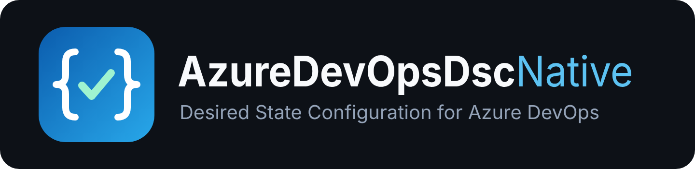

# Welcome to the AzureDevOpsDscNative wiki

<sup>*AzureDevOpsDscNative v#.#.#*</sup>

Here you will find all the information you need to make use of the AzureDevOpsDscNative
DSC resources in the latest release. This includes details of the resources that are
available, current capabilities, known issues, and information to help plan a DSC based
implementation of AzureDevOpsDscNative.

Please leave comments, feature requests, and bug reports for this module in the
[issues section](https://github.com/ZanattaMichael/AzureDevOpsDsc/issues) for this repository.

> **Note:** This is a native DSC v3 module where every resource is discoverable and invokable
> by `dsc.exe` via the `Microsoft.Adapter/PowerShell` adapter, using generated adapted resource
> manifests. No wrapper resources required.

## About AzureDevOpsDscNative

**AzureDevOpsDscNative** is a comprehensive DSC module that enables you to:

- **Manage Projects**: Create and configure Azure DevOps projects with specific settings
- **Control Permissions**: Define fine-grained permissions for users and groups across resources
- **Manage Teams**: Create and manage teams and team membership
- **Configure Repositories**: Manage Git repositories, permissions, and settings
- **Setup Pipelines**: Configure pipelines, environments, and pipeline settings
- **Manage Service Connections**: Create and manage service connections for CI/CD
- **Configure Variable Groups**: Create and manage variable groups
- **Manage Artifacts**: Configure artifact feeds and permissions
- **Setup Infrastructure**: Manage agent pools, deployment groups, and other infrastructure
- **Apply Policies**: Configure branch policies and other governance settings

> **Upgrading from 1.x?** Version 2.0 changes how the credential is passed and stored. Read
> [Upgrading to 2.0](Upgrading-to-2.0) first.

## Getting started

The module needs **PowerShell 7.0 or later**.

1. Install it from the
   [PowerShell Gallery](https://www.powershellgallery.com/packages/AzureDevOpsDscNative).

    ```powershell
    Install-PSResource -Name AzureDevOpsDscNative
    ```

1. Choose a private, local folder for the module's settings and cache.

    ```powershell
    $env:AZDODSC_CACHE_DIRECTORY = Join-Path $HOME '.azuredevopsdsc'
    ```

1. Sign in once. This stores the credential and builds the cache.

    ```powershell
    $pat = Read-Host -Prompt 'Personal access token' -AsSecureString
    New-AzDoAuthenticationProvider -OrganizationName 'my-organization' -SecureStringPersonalAccessToken $pat
    ```

1. Apply a resource.

    ```powershell
    $properties = @{
        ProjectName        = 'MySampleProject'
        ProjectDescription = 'This is a sample Azure DevOps project.'
    }

    Invoke-DscResource -Name AzDoProject -ModuleName AzureDevOpsDscNative -Method Set -Property $properties
    ```

A personal access token is the quickest way to try the module. For anything unattended, use a
managed identity or workload identity federation: see the [Authentication Guide](Authentication).

## Guides

| Guide | What it covers |
|---|---|
| [Authentication](Authentication) | Every sign-in method, the setup each needs in Azure DevOps and Microsoft Entra ID, and what is stored. |
| [Upgrading to 2.0](Upgrading-to-2.0) | The breaking changes in 2.0 and how to move from 1.x. |
| [Using the module with DSC v3](DscV3) | Running resources and configuration documents with the `dsc` command-line tool. |
| [Pipeline Runner Configuration](LCMConfiguration) | Applying configurations at scale with the companion Dsc.PipelineRunner project. |
| [Caching](Caching) | What the module caches, when it changes and how to reset it. |
| [Permissions & ACLs](Permissions) | The permission resources, identity syntax and permission names. |
| [Best Practices](BestPractices) | Recommendations for identities, secrets, configurations and runs. |
| [Troubleshooting](Troubleshooting) | Error messages and what to do about them. |
| [FAQ](FAQ) | Short answers to common questions. |

More in the repository:

- [USAGE.md](https://github.com/ZanattaMichael/AzureDevOpsDsc/blob/main/USAGE.md): environment
  variables, logging, export and secret references.
- [SECURITY.md](https://github.com/ZanattaMichael/AzureDevOpsDsc/blob/main/SECURITY.md): how to
  report a vulnerability, and how the module protects the credential.
- [CONTRIBUTING.md](https://github.com/ZanattaMichael/AzureDevOpsDsc/blob/main/CONTRIBUTING.md):
  building, testing and adding a resource.

## Resources

Every resource has a page, listed in the sidebar, with its properties and examples. The
[README](https://github.com/ZanattaMichael/AzureDevOpsDsc#resources) groups them by area:

- Projects, organization, groups and teams
- Repositories and policies
- Permissions
- Pipelines, environments and agents
- Classic Release Management
- Boards and work items
- Test management
- Process customization
- Artifacts, wiki, extensions and auditing

## Change log

A full list of changes in each version is in the
[change log](https://github.com/ZanattaMichael/AzureDevOpsDsc/blob/main/CHANGELOG.md).
